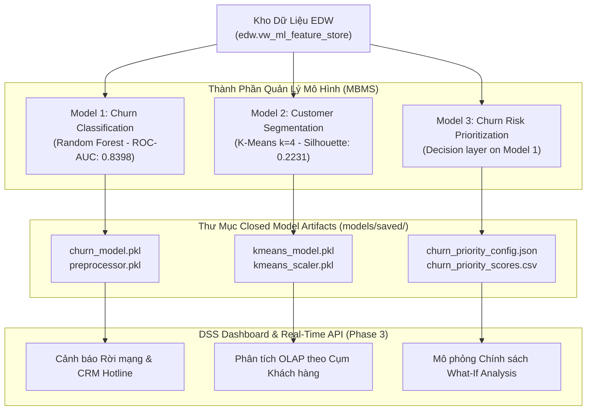

# 🧠 BÁO CÁO CHUYÊN ĐỀ MACHINE LEARNING & MODEL MANAGEMENT (PHASE 2 - MBMS)

> **Dự án**: CO4031 - Telecom Data Warehouse & Decision Support System (DSS)  
> **Trường**: Đại học Bách Khoa TP.HCM (HCMUT) - Khoa KH&KT Máy tính  
> **Tác giả**: ML Engineer Agent  
> **Dữ liệu đầu vào**: `edw.vw_ml_feature_store` (Data Warehouse Star Schema)  
> **Ngày hoàn thành**: 2026-10-10

---

## 1. TỔNG QUAN HỆ THỐNG QUẢN LÝ MÔ HÌNH (MBMS OVERVIEW)

Trong kiến trúc 3 thành phần của Hệ hỗ trợ ra quyết định (DSS), **Thành phần Quản lý Mô hình (Model-based Management System - MBMS)** đóng vai trò cung cấp tri thức tiên đoán (Predictive Analytics) và phân nhóm (Customer Insights) cho nhà quản trị.

Tất cả 3 mô hình học máy đều đọc dữ liệu trực tiếp từ kho dữ liệu sạch `edw.vw_ml_feature_store` (7,043 bản ghi):

---

## 2. TỔNG HỢP KẾT QUẢ 3 MÔ HÌNH MACHINE LEARNING

### 2.1. Model 1: Phân loại Rời mạng Khách hàng (Churn Classification)
- **Tệp mã nguồn**: [`models/churn_classification.py`](file:///c:/Users/Admin/Documents/HocTap/University/261/DW%20&%20DSS/Assignment/co4031-telecom-dss/models/churn_classification.py)
- **Tài liệu đặc tả**: [`docs/model_01_churn_classification.md`](file:///c:/Users/Admin/Documents/HocTap/University/261/DW%20&%20DSS/Assignment/co4031-telecom-dss/docs/model_01_churn_classification.md)
- **Thuật toán tối ưu nhất**: **Random Forest Classifier** (`class_weight='balanced'`).
- **Hiệu năng đạt được**:
  - **ROC-AUC**: **0.8398**
  - **Recall (Churn=1)**: **75.67%** (Ưu tiên không bỏ sót khách hàng rời mạng)
  - **F1-Score**: **0.6247**; **PR-AUC**: **0.6452**
  - **5-fold CV ROC-AUC**: **0.8464 +/- 0.0108**
- **Artifacts**: `models/saved/churn_model.pkl`, `models/saved/preprocessor.pkl`, `models/saved/churn_threshold.pkl`.

### 2.2. Model 2: Phân khúc Khách hàng (Customer Segmentation - K-Means)
- **Tệp mã nguồn**: [`models/customer_segmentation.py`](file:///c:/Users/Admin/Documents/HocTap/University/261/DW%20&%20DSS/Assignment/co4031-telecom-dss/models/customer_segmentation.py)
- **Tài liệu đặc tả**: [`docs/model_02_customer_segmentation.md`](file:///c:/Users/Admin/Documents/HocTap/University/261/DW%20&%20DSS/Assignment/co4031-telecom-dss/docs/model_02_customer_segmentation.md)
- **Thuật toán**: **K-Means Clustering** với chuẩn hóa `StandardScaler()`.
- **Số cụm được chọn**: **$k = 4$ cụm** (cân bằng giữa Elbow, kích thước cụm và khả năng diễn giải nghiệp vụ).
- **Silhouette**: **0.2231**; **Adjusted Rand Index stability**: **0.9444 +/- 0.1454**.
- **Phân khúc đặc trưng**:
  1. *Cụm 0 (New Standard - 29.39%)*: Khách hàng mới, cước phí cơ bản ($26.64/tháng), churn thấp (12.22%).
  2. *Cụm 1 (High-Risk Loyalists - 11.78%)*: Khách hàng cước cao ($76.82/tháng), rủi ro rời mạng báo động (**50.72%**).
  3. *Cụm 2 (Economy / Low-Cost - 30.88%)*: Khách hàng sử dụng ngắn hạn, tỷ lệ churn cao (42.62%).
  4. *Cụm 3 (Premium Subscribers - 27.94%)*: Khách hàng trung thành VIP (59.3 tháng), cước cao ($90.71/tháng), churn rất thấp (13.62%).
- **Artifacts**: `models/saved/kmeans_model.pkl`, `models/saved/kmeans_scaler.pkl`.

### 2.3. Model 3: Churn Risk Scoring & Retention Prioritization
- **Tệp mã nguồn**: [`models/churn_risk_prioritization.py`](file:///c:/Users/Admin/Documents/HocTap/University/261/DW%20&%20DSS/Assignment/co4031-telecom-dss/models/churn_risk_prioritization.py)
- **Tài liệu đặc tả**: [`docs/model_03_churn_risk_prioritization.md`](file:///c:/Users/Admin/Documents/HocTap/University/261/DW%20&%20DSS/Assignment/co4031-telecom-dss/docs/model_03_churn_risk_prioritization.md)
- **Bản chất**: Decision layer trên xác suất churn của Model 1, không phải model dự báo độc lập.
- **Input**: Churn probability, monthly charges, contract opportunity và service opportunity.
- **Output**: Priority score, risk tier, priority rank và nhóm top 5%/10%/20%.
- **Metrics**: Precision@K, Recall@K và Lift@K được tính trên 5-fold out-of-fold probabilities.
- **Kết quả**: Top 5% đạt Precision@K **83.29%**, Recall@K **15.73%**, Lift **3.14x**; Top 10% đạt Precision@K **74.89%**, Recall@K **28.25%**, Lift **2.82x**.
- **Artifacts**: `models/saved/churn_priority_config.json`, `models/evaluation/churn_priority_scores.csv`, `models/evaluation/churn_priority_metrics.csv`.

---

## 3. DANH SÁCH TỆP VÀ HÌNH ẢNH ĐÁNH GIÁ (EVALUATION ASSETS)

Tất cả biểu đồ đánh giá đã được xuất tự động vào thư mục [`models/evaluation/`](file:///c:/Users/Admin/Documents/HocTap/University/261/DW%20&%20DSS/Assignment/co4031-telecom-dss/models/evaluation/):
- [`churn_confusion_matrix.png`](file:///c:/Users/Admin/Documents/HocTap/University/261/DW%20&%20DSS/Assignment/co4031-telecom-dss/models/evaluation/churn_confusion_matrix.png) — Confusion Matrix mô hình Churn.
- [`churn_roc_curve.png`](file:///c:/Users/Admin/Documents/HocTap/University/261/DW%20&%20DSS/Assignment/co4031-telecom-dss/models/evaluation/churn_roc_curve.png) — Đồ thị đường cong ROC so sánh 3 thuật toán Churn.
- [`churn_feature_importance.png`](file:///c:/Users/Admin/Documents/HocTap/University/261/DW%20&%20DSS/Assignment/co4031-telecom-dss/models/evaluation/churn_feature_importance.png) — Top 15 thuộc tính quan trọng nhất tác động Churn.
- `models/evaluation/churn_metrics.csv`, `models/evaluation/kmeans_metrics.csv`, `models/evaluation/churn_priority_metrics.csv` — Bảng metric có thể tái lập từ pipeline.
- `models/evaluation/churn_priority_scores.csv` — Bảng xếp hạng ưu tiên retention theo customer.
- `models/evaluation/churn_priority_metrics.csv` — Precision@K, Recall@K và Lift@K của lớp ưu tiên retention.
- [`kmeans_elbow_silhouette.png`](file:///c:/Users/Admin/Documents/HocTap/University/261/DW%20&%20DSS/Assignment/co4031-telecom-dss/models/evaluation/kmeans_elbow_silhouette.png) — Biểu đồ Elbow & Silhouette chọn k.
- [`kmeans_pca_scatter.png`](file:///c:/Users/Admin/Documents/HocTap/University/261/DW%20&%20DSS/Assignment/co4031-telecom-dss/models/evaluation/kmeans_pca_scatter.png) — Đồ thị không gian 2D PCA phân cụm.
- [`kmeans_cluster_profile.png`](file:///c:/Users/Admin/Documents/HocTap/University/261/DW%20&%20DSS/Assignment/co4031-telecom-dss/models/evaluation/kmeans_cluster_profile.png) — Biểu đồ so sánh chỉ số giữa 4 cụm.

---

## 4. BIÊN BẢN BÀN GIAO CHO BACKEND & DASHBOARD AGENT (PHASE 3 HANDOFF)

| Tệp Đóng Gói Model | Mô Tả Chức Năng | API / Hàm Gọi Trong Dashboard |
| :--- | :--- | :--- |
| `models/saved/churn_model.pkl` | Model phân loại Churn | `model.predict_proba(X_trans)` |
| `models/saved/preprocessor.pkl` | Preprocessor hóa thuộc tính cho Churn | `preprocessor.transform(df_input)` |
| `models/saved/kmeans_model.pkl` | Model phân cụm khách hàng (k=4) | `kmeans.predict(X_scaled)` |
| `models/saved/kmeans_scaler.pkl` | Scaler cho thuộc tính phân cụm | `scaler.transform(df_cluster_input)` |
| `models/saved/churn_priority_config.json` | Trọng số và assumptions của priority score | Đọc config trước khi xếp hạng |
| `models/evaluation/churn_priority_scores.csv` | Điểm và thứ hạng ưu tiên retention | Lọc top K trong dashboard |

**PHASE 2 (MACHINE LEARNING MBMS) đã hoàn tất pipeline và artifact.** K-Means được giữ ở `k=4` theo tiêu chí nghiệp vụ, nhưng Silhouette `0.2231` cần được trình bày như một hạn chế của dữ liệu.
